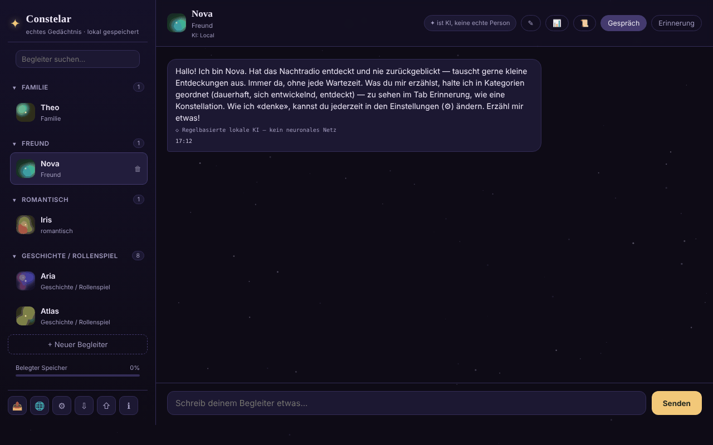

# Constelar

[English](README.md) · [Română](README.ro.md) · [Français](README.fr.md) · [Italiano](README.it.md) · [Español](README.es.md) · [Português](README.pt.md) · **Deutsch** · [Magyar](README.hu.md)

**Version:** 1.3.7 · **Zuletzt aktualisiert:** 2026-10-23

Oberflächensprachen: **Română, English, Français, Italiano, Español, Português (PT), Deutsch, Magyar**

KI-Begleiter mit echtem Gedächtnis, lokal im Browser gespeichert, in einer einzigen HTML-Datei.

**Online-Anwendung:** https://chiuta.github.io/Constelar/

## Was es ist

Constelar ist eine Anwendung (optional als PWA), in der du einen oder mehrere KI-„Begleiter“ erstellst (Familie, Freund, romantisch, Geschichte / Rollenspiel), jeweils mit eigener Persönlichkeit, eigenem Kontext und einem eigenen Gedächtnis, das als Sternbild dargestellt wird. Die Daten bleiben im Browser; nichts verlässt das Gerät, es sei denn, du wählst einen externen KI-Anbieter oder lädst ein WebLLM-Modell herunter. Die Anwendung ist für Erwachsene gedacht und ersetzt weder menschliche Beziehungen noch eine Therapie (Hinweis in der Anwendung).

## Funktionen

- Mehrere Begleiter: Name, Beziehungsart, Eigenschaften, Kontext / Hintergrundgeschichte, eigener KI-Anbieter oder der globale; eine Schaltfläche zum zufälligen Erzeugen eines Begleiters.
- Zwei Tabs für jeden Begleiter: **Chat** und **Memory**. Das Gedächtnis hat drei Kategorien: *Permanent*, *Evolving*, *Discovered* (Letztere mit optionaler automatischer Extraktion), dargestellt als Sterne, die du für Details antippen kannst.
- KI-Anbieter in den Einstellungen: WebLLM (im Tab über WebGPU ausgeführtes Modell, einmal heruntergeladen, Varianten 1B / 3B / 8B), Anthropic (Claude), OpenAI-kompatibel (Voreinstellungen Groq, OpenRouter, Together, Mistral, DeepSeek, xAI, Ollama), Pollinations (ohne Konto), natives Gemini Nano von Chrome und eine einfache regelbasierte lokale Engine (kein neuronales Netz; im Chat entsprechend gekennzeichnet).
- „Test connection“, „It's AI“-Erinnerung in konfigurierbarem Abstand (Minuten; 0 = aus), Vorlesen der Antworten (speechSynthesis).
- Lokale Extraktion von Fakten aus Nachrichten (Vorlieben, Ängste, nahestehende Personen und Tiere, Beruf, Wohnort) in den 8 Sprachen, angezeigt unter „Discovered“.
- Zusammenfassung der Unterhaltung („Conversation recap“, lokal nach Worthäufigkeit berechnet) und Export einer Unterhaltung.
- Export / Import aller Daten (⇩ / ⇧).
- Schaltfläche „Nachricht kopieren“ (⧉) bei jeder Nachricht; Entwürfe im Nachrichtenfeld werden pro Begleiter gespeichert (auch nach dem Neuladen).
- Krisenressourcen über die Seitenleiste erreichbar und ein Sicherheitsdialog, wenn bestimmte Ausdrücke erkannt werden.
- Menü „Share“ (Link, WhatsApp, X, Facebook, LinkedIn, Fediverse).
- Oberfläche in 8 Sprachen: Englisch, Rumänisch, Französisch, Italienisch, Spanisch, Portugiesisch, Deutsch, Ungarisch.

## Bedienungsanleitung

1. Öffne die Seite und drücke „+ New companion“ (oder „+ Create your first companion“).
2. Fülle Name, Beziehungsart, Eigenschaften und Kontext aus; wähle den KI-Anbieter („Same as Settings (global)“ oder einen anderen), dann „Create“.
3. Schreibe im Tab **Chat** die Nachricht und drücke „Send“ oder `Enter` (`Shift+Enter` für eine neue Zeile).
4. Füge im Tab **Memory** mit „+“ Erinnerungen in den Kategorien Permanent / Evolving / Discovered hinzu.
5. Für eine echte KI öffne ⚙ (AI Settings), wähle „Provider“, gib den API-Schlüssel ein (und gegebenenfalls „Base URL“ / „Model“), nutze „Test connection“ und dann „Save“. Für WebLLM drücke „Download and start the model“.
6. Ändere die Sprache über die Schaltfläche 🌐 oder über die Auswahl „Language“ in den Einstellungen.
7. Sichere die Daten mit ⇩ (Export) und stelle sie mit ⇧ (Import) wieder her.
8. `Esc` schließt die modalen Fenster. ℹ öffnet „About Constelar“ sowie die Nutzungsbedingungen/den Datenschutz.

## Datenschutz und Netzwerk

- **Lokale Speicherung:** `localStorage`, Schlüssel `constelar_state_v1` (Begleiter, Erinnerungen, Unterhaltungen, Einstellungen; ohne den API-Schlüssel: Der Schlüssel liegt im `sessionStorage` (bis zum Schließen des Tabs) oder, nur wenn du „Auf diesem Gerät merken“ aktivierst, im separaten Schlüssel `constelar_apikey_persist`). Entwürfe ungesendeter Nachrichten werden getrennt im Schlüssel `constelar_drafts_v1` gespeichert (beim Senden gelöscht). Die Anwendung prüft die Verfügbarkeit von `localStorage` und warnt, falls es nicht funktioniert. Keine Cookies.
- **Kontaktierte Hosts, nur auf deine Aktion hin:**
  - der gewählte KI-Anbieter: `api.anthropic.com`, `api.openai.com` oder eine andere Base URL (einschließlich `openrouter.ai` in den Voreinstellungen), wobei Nachrichten und Schlüssel direkt aus dem Browser gesendet werden;
  - `text.pollinations.ai`, wenn du Pollinations wählst (die Anwendung fragt einmalig nach der Zustimmung);
  - `raw.githubusercontent.com/mlc-ai/binary-mlc-llm-libs/00fe7a40…/` (die Modellbibliothek `.wasm`, fester Commit, per SHA-256-SRI geprüft) und `huggingface.co/mlc-ai/` (+ `*.huggingface.co`, `*.hf.co`) für die Gewichte des gewählten Modells (ohne festen Hash), wenn du WebLLM verwendest (die Bibliothek `@mlc-ai/web-llm@0.2.84` selbst liegt in `vendor/`);
  - die Links zu `iasp.info` (Krisenressourcen) und die „Share“-Schaltflächen öffnen sich nur beim Klicken.
- Keine Analysedienste. Die Seite hat eine CSP-Richtlinie (Meta) mit `script-src` per SHA-256-Hash für das eigene Skript (ohne `'unsafe-inline'`); `connect-src` erlaubt `https:`, weil die URL des OpenAI-kompatiblen Anbieters vom Nutzer gewählt wird. Die Modellnamen in den Voreinstellungen (Groq, OpenRouter, Together, Mistral usw.) ändern sich oft und konnten am 11.10.2026 nicht geprüft werden: Bearbeite das Feld „Model“, wenn ein Anbieter mit einem Fehler antwortet. Mit dem Standardanbieter „einfache lokale Engine“ oder mit bereits heruntergeladenen Modellen verlassen die Unterhaltungen das Gerät nicht.
- Wenn die Seite über HTTPS ausgeliefert wird, registriert sich `sw.js` (optional) und speichert die „App-Shell“ im Cache; es berührt `localStorage` nicht.

## Lokal / offline ausführen

Lade `index.html` herunter (optional auch `sw.js`, für die Installation als App auf einem HTTPS-Server) und öffne die Datei im Browser. Ohne Internet funktionieren die einfache lokale Engine und die bereits im Cache heruntergeladenen WebLLM-Modelle; externe Anbieter und der erste WebLLM-Download erfordern Internet.

## Lizenz

MIT für den Code und die Struktur der Anwendung — siehe Datei `LICENSE`. Eventuell in der Datei enthaltene Bibliotheken Dritter behalten ihre eigenen Lizenzen. Vom Nutzer erstellte Inhalte bleiben dessen Eigentum.

## Audit

Audit: 2026-10-10 — geprüft mit Playwright und axe-core; die Inhaltsdarstellung (Nachrichten, Erinnerungen, Zusammenfassung) verwendet `escapeHtml` (getestet mit einer ``-Nutzlast); der Datenexport leert den API-Schlüssel. Behoben: die obere Leiste auf schmalem Bildschirm (der Tab „Memory“ lag außerhalb des Bildschirms). Runde 2 (2026-10-11): Die Formulierung „100 % lokal“ stand nur im Feld „About“ auf GitHub, nicht auf der Seite; der Seitentext (Meta-Beschreibung, „stored locally“, Einstellungen) ist zutreffend: Die Daten bleiben im Browser, und der Text geht nur an eine externe KI, an Pollinations oder an das CDN `esm.run` (WebLLM), wenn du diesen Anbieter wählst. Korrekter Text für „About“ (manuell auf GitHub anzuwenden): „KI-Begleiter mit lokal im Browser gespeichertem Gedächtnis; Nachrichten gehen nur an einen externen Anbieter, wenn du ihn wählst.“ Keine CSP und kein SRI für WebLLM: Der dynamische `import()` von `esm.run` kann kein `integrity`-Attribut tragen, und `connect-src` müsste jeden vom Nutzer gewählten Host erlauben (freie Base URL), sodass eine nützliche CSP genauso weit wäre wie gar keine.

## Verlauf / Changelog

- 1.3.5 — 2026-10-22: fff-kit 1.1.4: Touch-Ziele und Mindestschriftgröße
- 1.3.4 — 2026-10-22: Sicherheit: Der API-Schlüssel wird nicht mehr im Klartext im localStorage gespeichert; er liegt im sessionStorage (bis zum Schließen des Tabs), von älteren Versionen gespeicherte Schlüssel werden migriert und gelöscht, ein optionales Kästchen „Auf diesem Gerät merken“ (mit Warnhinweis) behält ihn bewusst, und Exporte enthalten ihn nie.
- 1.3.3 — 2026-10-22: fff-kit 1.1.2: PBKDF2 mit 600.000 Iterationen, Schutz vor Clickjacking
- 1.3.2 — 2026-10-22: Die Pollinations-Einwilligung, die Bestätigung unsicherer URLs, die Bestätigung des Überschreibens beim Import und die Sprach-/Import-Hinweise nutzen Dialoge und Hinweise in der Seite statt window.confirm/alert; Suchfeld und Nachrichtenfeld haben zugängliche Namen (übersetzt); nur ein h1 auf der Seite (die Marke), Name des Begleiters und Titel des leeren Zustands sind h2; größere Touch-Ziele und Text ≥ 12 px auf dem Handy.

- 1.3.1 — 2026-10-22: **Korrektur**: der Seitentitel folgt der gewählten Sprache; unveränderte Demo-Begleiter (Profil, Erinnerungen) werden beim Sprachwechsel in der neuen Sprache neu geschrieben.
### 1.3.6 — 2026-10-22
- WebLLM kommt nicht mehr von einem CDN: die Bibliothek `@mlc-ai/web-llm@0.2.84` und der Worker (`vendor/web-llm-worker.mjs`, eine echte Datei statt eines Blobs mit Import von `esm.run`) liegen in `vendor/`. Die Modellbibliotheken (`.wasm`) stammen von einem festen Commit von `binary-mlc-llm-libs` und werden per SHA-256-SRI geprüft (bei Abweichung abgelehnt, mit übersetzter Meldung). Die CSP entfernt `esm.run` und `cdn.jsdelivr.net` aus `script-src`.
- Neue Texte (Bibliothek nicht geladen, Integritätsfehler) in 8 Sprachen. Zusätzliche Größe: ca. 5,8 MB (WebLLM). Neue `NOTICE.md`.

### 1.2.0 — 2026-10-18
- Behoben: Der Import einer Begleiter-Datei ohne `settings` setzt Sprache, Anbieter und Modell nicht mehr zurück (die aktuellen bleiben erhalten).
- Die unverschlüsselte Sicherung (Kit 1.1.0) enthält den API-Schlüssel nicht mehr; die mit Passwort verschlüsselte behält ihn. Beim Wiederherstellen einer unverschlüsselten Sicherung wird der Schlüssel neu eingegeben.

### 1.1.0 — 2026-10-14
- Datensicherung und Datenkennzeichnung (fff-kit).

### 1.0.0 — 2026-10-12
- Die Version und das Datum der letzten Aktualisierung werden in der Anwendung angezeigt (Fenster „About“, in 7 Sprachen).

### 11. Oktober 2026 (Runde 7)
- Behoben: Bei „Was weißt du noch über mich?“ zitiert die lokale Engine jetzt nur echte Fakten über den Nutzer; die Willkommensnotiz des Demo-Begleiters unter „Discovered“ („Right now she's chatting through the instant local engine…“) wurde als Hinweis (`hint`) markiert und aus der Erinnerungsantwort, aus dem an die KI gesendeten Prompt und aus den Verweisen der lokalen Engine ausgeschlossen (auch für zuvor gespeicherte Daten, am Text erkannt). Reproduziert und im Browser geprüft.
- Verbessert: heuristische Faktenextraktion, in allen 7 Sprachen: „iubesc/I love/j'adore…“, „mi-e frică de/I'm afraid of/j'ai peur de…“, benannte Beziehungen und Tiere („my friend Maria“), und die behaltene Phrase wird an der ersten Konjunktion abgeschnitten („hiking and I'm afraid…“ → „hiking“). Die Engine bleibt heuristisch und begrenzt.

### 11. Oktober 2026 (Runde 6)
- Hinzugefügt: Kopierschaltfläche bei jeder Nachricht (in 7 Sprachen übersetzt), persistente Entwürfe pro Begleiter.
- Sicherheit: CSP mit `script-src` per Hash statt `'unsafe-inline'` (externe Quellen unverändert: `esm.run`, `cdn.jsdelivr.net`).

### 11. Oktober 2026
- Behoben: Die regelbasierte lokale Engine beantwortet jetzt Fragen über den Nutzer („What is my name?“, „Cine sunt?“, „Que sais-tu de moi ?“ usw., in allen 7 Sprachen) mit den „entdeckten“ Fakten aus dem Gedächtnis; ohne Fakten sagt sie ausdrücklich, dass sie nichts gespeichert hat.
- Behoben: Faktenzusammenfassungen (die Bestätigung „Good to know …“ und die automatisch extrahierten Fakten) werden nicht mehr mitten im Wort oder am Apostroph abgeschnitten (Grenze 30 → 80/60 Zeichen, mit Rückfall auf das letzte ganze Wort).
- Hinzugefügt: CSP-Richtlinie (connect-src `'self'`, `https:` für vom Nutzer konfigurierbare KI-Anbieter und Loopback-HTTP für Ollama/LM Studio; Skripte nur von `esm.run`/`cdn.jsdelivr.net` für WebLLM).
- Behoben: Barrierefreiheit: h1-Überschrift, benannte modale Fenster, Kontrast der Nachrichtenzeit; 0 axe-core-Verstöße bei 1280 und 360 px.

## Autor

Alexio — Alexandru-Ionuț Chiuță. Kontakt: alexio@trom.tf

## Zusammenfassung

Constelar ist eine Anwendung in einer einzigen Datei für KI-Begleiter mit lokalem, sichtbarem Gedächtnis (permanent / evolving / discovered). Die Daten liegen in localStorage (`constelar_state_v1`). KI-Anbieter: WebLLM im Tab, Anthropic, OpenAI-kompatibel, Pollinations, Gemini Nano von Chrome oder eine einfache regelbasierte lokale Engine. Externe Hosts werden nur kontaktiert, wenn du sie wählst (Anbieter-APIs, Modelldateien von Hugging Face/GitHub für WebLLM, Pollinations). Oberfläche in 8 Sprachen.
