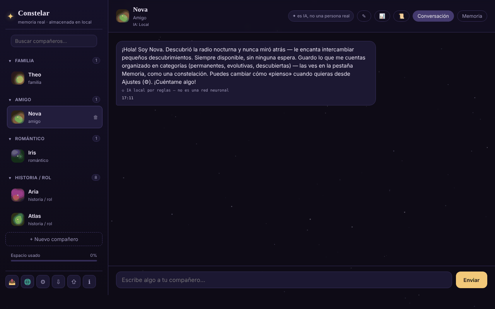

# Constelar

[English](README.md) · [Română](README.ro.md) · [Français](README.fr.md) · [Italiano](README.it.md) · **Español** · [Português](README.pt.md) · [Deutsch](README.de.md) · [Magyar](README.hu.md)

**Versión:** 1.3.9 · **Última actualización:** 2026-10-26

Idiomas de la interfaz: **Română, English, Français, Italiano, Español, Português (PT), Deutsch, Magyar**

Compañeros de IA con memoria real, almacenada localmente en el navegador, en un único archivo HTML.

**Aplicación en línea:** https://chiuta.github.io/Constelar/

## Qué es

Constelar es una aplicación (PWA opcional) en la que creas uno o varios «compañeros» de IA (familia, amigo, romántico, historia / juego de rol), cada uno con su personalidad, contexto y una memoria propia visualizada como una constelación. Los datos permanecen en el navegador; nada sale del dispositivo a menos que elijas un proveedor de IA externo o descargues un modelo WebLLM. La aplicación está pensada para adultos y no sustituye las relaciones humanas ni la terapia (nota en la aplicación).

## Funciones

- Varios compañeros: nombre, tipo de relación, rasgos, contexto / historia de fondo, proveedor de IA propio o el global; botón para generar un compañero al azar.
- Dos pestañas para cada compañero: **Chat** y **Memory**. La memoria tiene tres categorías: *Permanent*, *Evolving*, *Discovered* (esta última con extracción automática opcional), mostradas como estrellas que puedes tocar para ver los detalles.
- Proveedores de IA en Ajustes: WebLLM (modelo ejecutado en la pestaña mediante WebGPU, descargado una vez, variantes 1B / 3B / 8B), Anthropic (Claude), compatible con OpenAI (preajustes Groq, OpenRouter, Together, Mistral, DeepSeek, xAI, Ollama), Pollinations (sin cuenta), Gemini Nano nativo de Chrome y un motor local simple basado en reglas (no es una red neuronal; etiquetado como tal en el chat).
- «Test connection», recordatorio «It's AI» a intervalo configurable (minutos; 0 = desactivado), lectura en voz alta de las respuestas (speechSynthesis).
- Extracción local de hechos a partir de los mensajes (preferencias, miedos, personas y animales cercanos, ocupación, vivienda) en los 8 idiomas, mostrados en «Discovered».
- Resumen de la conversación («Conversation recap», calculado localmente según la frecuencia de las palabras) y exportación de una conversación.
- Exportación / importación de todos los datos (⇩ / ⇧).
- Botón «Copiar el mensaje» (⧉) en cada mensaje; los borradores del campo de mensaje se conservan por compañero (y tras recargar).
- Recursos de crisis accesibles desde la barra lateral y diálogo de seguridad cuando se detectan ciertas expresiones.
- Menú «Share» (enlace, WhatsApp, X, Facebook, LinkedIn, Fediverso).
- Interfaz en 8 idiomas: inglés, rumano, francés, italiano, español, portugués, alemán, húngaro.

## Manual de uso

1. Abre la página y pulsa «+ New companion» (o «+ Create your first companion»).
2. Rellena el nombre, el tipo de relación, los rasgos y el contexto; elige el proveedor de IA («Same as Settings (global)» u otro) y luego «Create».
3. En la pestaña **Chat** escribe el mensaje y pulsa «Send» o `Enter` (`Shift+Enter` para una nueva línea).
4. En la pestaña **Memory** añade recuerdos con «+» en las categorías Permanent / Evolving / Discovered.
5. Para una IA real, abre ⚙ (AI Settings), elige «Provider», introduce la clave API (y, si procede, «Base URL» / «Model»), usa «Test connection» y luego «Save». Para WebLLM pulsa «Download and start the model».
6. Cambia el idioma con el botón 🌐 o con el selector «Language» de Ajustes.
7. Guarda los datos con ⇩ (exportar) y restáuralos con ⇧ (importar).
8. `Esc` cierra las ventanas modales. ℹ abre «About Constelar» y los términos/la privacidad.

## Privacidad y red

- **Almacenamiento local:** `localStorage`, clave `constelar_state_v1` (compañeros, recuerdos, conversaciones, ajustes; sin la clave API: la clave se conserva en `sessionStorage` (hasta cerrar la pestaña) o, solo si marcas «Recordar en este dispositivo», en la clave separada `constelar_apikey_persist`). Los borradores de mensajes no enviados se guardan por separado, en la clave `constelar_drafts_v1` (se borran al enviar). La aplicación comprueba la disponibilidad de `localStorage` y avisa si no funciona. Sin cookies.
- **Hosts contactados, solo por una acción tuya:**
  - el proveedor de IA elegido: `api.anthropic.com`, `api.openai.com` u otra Base URL (incluido `openrouter.ai` en los preajustes), con los mensajes y la clave enviados directamente desde el navegador;
  - `text.pollinations.ai`, si eliges Pollinations (la aplicación pide el consentimiento una sola vez);
  - `raw.githubusercontent.com/mlc-ai/binary-mlc-llm-libs/00fe7a40…/` (la biblioteca del modelo `.wasm`, commit fijado, verificada con SRI SHA-256) y `huggingface.co/mlc-ai/` (+ `*.huggingface.co`, `*.hf.co`) para los pesos del modelo elegido (sin hash fijado), si usas WebLLM (la biblioteca `@mlc-ai/web-llm@0.2.84` en sí está en `vendor/`);
  - los enlaces a `iasp.info` (recursos de crisis) y los botones «Share» se abren solo al hacer clic.
- Sin analíticas. La página tiene una política CSP (meta), con `script-src` mediante hash SHA-256 para su propio script (sin `'unsafe-inline'`); `connect-src` permite `https:` porque la URL del proveedor compatible con OpenAI la elige el usuario. Los nombres de modelos de los preajustes (Groq, OpenRouter, Together, Mistral, etc.) cambian con frecuencia y no pudieron verificarse el 11.10.2026: edita el campo «Model» si un proveedor responde con un error. Con el proveedor predeterminado «motor local simple» o con modelos ya descargados, las conversaciones no salen del dispositivo.
- Cuando se sirve por HTTPS, `sw.js` (opcional) se registra y guarda en caché el «app shell»; no toca `localStorage`.

## Ejecución local / sin conexión

Descarga `index.html` (opcionalmente también `sw.js`, para instalarlo como aplicación en un servidor HTTPS) y ábrelo en el navegador. Sin internet funcionan el motor local simple y los modelos WebLLM ya descargados en la caché; los proveedores externos y la primera descarga de WebLLM requieren internet.

## Licencia

MIT para el código y la estructura de la aplicación — consulta el archivo `LICENSE`. Las eventuales bibliotecas de terceros incluidas en el archivo conservan sus propias licencias. El contenido creado por el usuario sigue siendo suyo.

## Auditoría

Auditoría: 2026-10-10 — verificado con Playwright y axe-core; los renderizados de contenido (mensajes, recuerdos, resumen) usan `escapeHtml` (probado con una carga ``); la exportación de datos vacía la clave API. Corregido: la barra superior en pantalla estrecha (la pestaña «Memory» se salía de la pantalla). Ronda 2 (2026-10-11): la expresión «100% local» aparecía solo en el campo «About» de GitHub, no en la página; el texto de la página (meta description, «stored locally», ajustes) es exacto: los datos permanecen en el navegador, y el texto sale hacia una IA externa, hacia Pollinations o hacia el CDN `esm.run` (WebLLM) solo si eliges ese proveedor. Texto correcto para «About» (para aplicar manualmente en GitHub): «Compañeros de IA con memoria almacenada localmente en el navegador; los mensajes salen hacia un proveedor externo solo si tú lo eliges.» Sin CSP ni SRI en WebLLM: el `import()` dinámico desde `esm.run` no puede llevar el atributo `integrity`, y `connect-src` tendría que permitir cualquier host elegido por el usuario (Base URL libre), por lo que una CSP útil sería tan amplia como no tener ninguna.

## Historial / Changelog

- 1.3.5 — 2026-10-22: fff-kit 1.1.4: objetivos táctiles y tamaño mínimo de texto
- 1.3.4 — 2026-10-22: Seguridad: la clave API ya no se guarda en claro en localStorage; se conserva en sessionStorage (hasta cerrar la pestaña), las claves guardadas por versiones anteriores se migran y se eliminan, una casilla opcional «Recordar en este dispositivo» (con aviso) la conserva a propósito, y las exportaciones nunca la incluyen.
- 1.3.3 — 2026-10-22: fff-kit 1.1.2: PBKDF2 600 000 iteraciones, protección anti-clickjacking
- 1.3.2 — 2026-10-22: El consentimiento de Pollinations, la confirmación de URL insegura, la confirmación de sobrescritura al importar y los avisos de voz/importación usan diálogos y avisos integrados en lugar de window.confirm/alert; el campo de búsqueda y el cuadro de mensaje tienen nombres accesibles (traducidos); un solo h1 en la página (la marca), el nombre del compañero y el título del estado vacío son h2; zonas táctiles más grandes y texto ≥ 12 px en móvil.

- 1.3.1 — 2026-10-22: **corrección**: el título de la página sigue el idioma elegido; los compañeros de demostración sin modificar (perfil, recuerdos) se reescriben en el nuevo idioma al cambiar de idioma.
### 1.3.6 — 2026-10-22
- WebLLM ya no viene de un CDN: la biblioteca `@mlc-ai/web-llm@0.2.84` y el worker (`vendor/web-llm-worker.mjs`, un archivo real en lugar de un blob que importaba de `esm.run`) están en `vendor/`. Las bibliotecas de modelo (`.wasm`) vienen de un commit fijado de `binary-mlc-llm-libs` y se verifican con SRI SHA-256 (se rechazan si difieren, con mensaje traducido). La CSP quita `esm.run` y `cdn.jsdelivr.net` de `script-src`.
- Textos nuevos (biblioteca no cargada, fallo de integridad) en 8 idiomas. Tamaño añadido: ~5,8 MB (WebLLM). Nuevo `NOTICE.md`.

### 1.2.0 — 2026-10-18
- Corregido: importar un archivo de compañeros sin `settings` ya no restablece el idioma, el proveedor y el modelo (se mantienen los actuales).
- La copia de seguridad sin cifrar (kit 1.1.0) ya no contiene la clave API; la cifrada con contraseña la conserva. Al restaurar una copia sin cifrar, la clave se vuelve a introducir.

### 1.1.0 — 2026-10-14
- Copia de seguridad y etiquetado de datos (fff-kit).

### 1.0.0 — 2026-10-12
- La versión y la fecha de la última actualización se muestran en la aplicación (ventana «About», en 7 idiomas).

### 11 de octubre de 2026 (ronda 7)
- Corregido: ante «¿qué recuerdas de mí?» el motor local cita ahora solo hechos reales sobre el usuario; la nota de bienvenida del compañero de demostración en «Discovered» («Right now she's chatting through the instant local engine…») se marcó como pista (`hint`) y se excluyó de la respuesta de recuerdo, del prompt enviado a la IA y de las referencias del motor local (incluso para datos guardados antes, reconocida por su texto). Reproducido y verificado en el navegador.
- Mejorado: extracción heurística de hechos, en los 7 idiomas: «iubesc/I love/j'adore…», «mi-e frică de/I'm afraid of/j'ai peur de…», relaciones y animales con nombre («my friend Maria»), y la frase retenida se corta en la primera conjunción («hiking and I'm afraid…» → «hiking»). El motor sigue siendo heurístico y limitado.

### 11 de octubre de 2026 (ronda 6)
- Añadido: botón de copia en cada mensaje (traducido a 7 idiomas), borradores persistentes por compañero.
- Seguridad: CSP con `script-src` mediante hash en lugar de `'unsafe-inline'` (fuentes externas sin cambios: `esm.run`, `cdn.jsdelivr.net`).

### 11 de octubre de 2026
- Corregido: el motor local basado en reglas responde ahora a preguntas sobre el usuario («What is my name?», «Cine sunt?», «Que sais-tu de moi ?», etc., en los 7 idiomas) con los hechos «descubiertos» en la memoria; sin hechos, dice explícitamente que no tiene nada guardado.
- Corregido: los resúmenes de hechos (la confirmación «Good to know …» y los hechos extraídos automáticamente) ya no se cortan a mitad de palabra ni en el apóstrofo (límite 30 → 80/60 caracteres, con retroceso a la última palabra completa).
- Añadido: política CSP (connect-src `'self'`, `https:` para los proveedores de IA configurables por el usuario y HTTP loopback para Ollama/LM Studio; scripts solo desde `esm.run`/`cdn.jsdelivr.net` para WebLLM).
- Corregido: accesibilidad: título h1, ventanas modales con nombre, contraste de la hora de los mensajes; 0 infracciones de axe-core a 1280 y 360 px.

## Autor

Alexio — Alexandru-Ionuț Chiuță. Contacto: alexio@trom.tf

## Resumen

Constelar es una aplicación de un solo archivo para compañeros de IA con memoria local y visible (permanent / evolving / discovered). Los datos residen en localStorage (`constelar_state_v1`). Proveedores de IA: WebLLM en la pestaña, Anthropic, compatible con OpenAI, Pollinations, Gemini Nano de Chrome o un motor local simple basado en reglas. Los hosts externos solo se contactan cuando los eliges (API de los proveedores, archivos de modelo de Hugging Face/GitHub para WebLLM, Pollinations). Interfaz en 8 idiomas.
