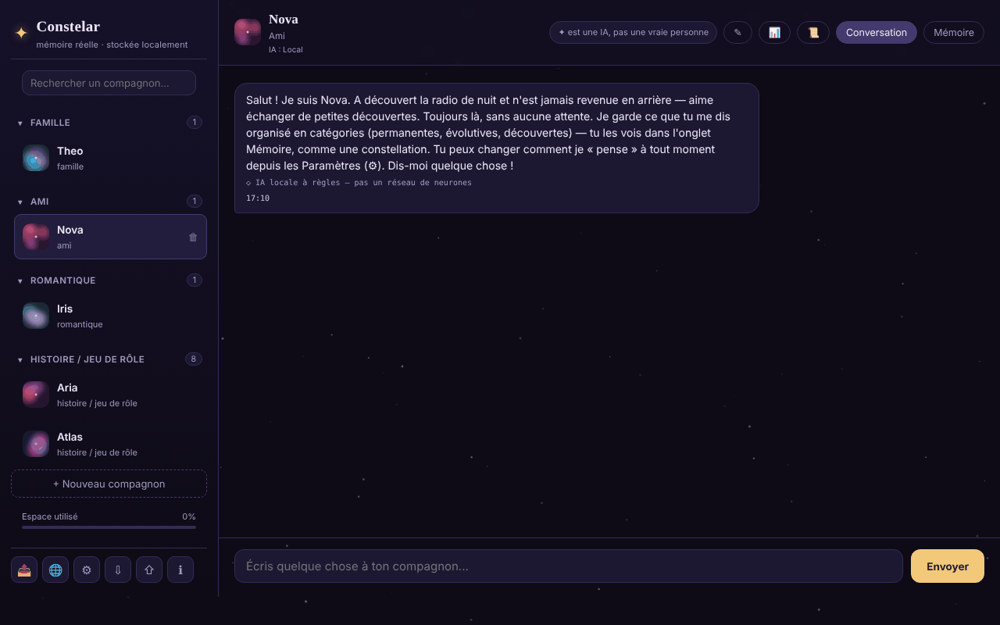

# Constelar

[English](README.md) · [Română](README.ro.md) · **Français** · [Italiano](README.it.md) · [Español](README.es.md) · [Português](README.pt.md) · [Deutsch](README.de.md) · [Magyar](README.hu.md)

**Version :** 1.3.8 · **Dernière mise à jour :** 2026-10-23

Langues de l'interface : **Română, English, Français, Italiano, Español, Português (PT), Deutsch, Magyar**

Des compagnons IA dotés d'une vraie mémoire, stockée localement dans le navigateur, dans un seul fichier HTML.

**Application en ligne :** https://chiuta.github.io/Constelar/

## De quoi s'agit-il

Constelar est une application (PWA en option) dans laquelle vous créez un ou plusieurs « compagnons » IA (famille, ami, romantique, histoire / jeu de rôle), chacun avec sa personnalité, son contexte et une mémoire propre visualisée comme une constellation. Les données restent dans le navigateur ; rien ne quitte l'appareil, sauf si vous choisissez un fournisseur d'IA externe ou téléchargez un modèle WebLLM. L'application est conçue pour les adultes et ne remplace ni les relations humaines ni la thérapie (note dans l'application).

## Fonctionnalités

- Compagnons multiples : nom, type de relation, traits, contexte / histoire de fond, fournisseur d'IA propre ou global ; bouton de génération aléatoire d'un compagnon.
- Deux onglets pour chaque compagnon : **Chat** et **Memory**. La mémoire comporte trois catégories : *Permanent*, *Evolving*, *Discovered* (cette dernière avec extraction automatique facultative), affichées comme des étoiles sur lesquelles vous pouvez toucher pour voir les détails.
- Fournisseurs d'IA dans les Paramètres : WebLLM (modèle exécuté dans l'onglet via WebGPU, téléchargé une fois, variantes 1B / 3B / 8B), Anthropic (Claude), compatible OpenAI (préréglages Groq, OpenRouter, Together, Mistral, DeepSeek, xAI, Ollama), Pollinations (sans compte), Gemini Nano natif de Chrome et un moteur local simple à base de règles (ce n'est pas un réseau de neurones ; étiqueté comme tel dans le chat).
- « Test connection », rappel « It's AI » à intervalle configurable (minutes ; 0 = désactivé), lecture à voix haute des réponses (speechSynthesis).
- Extraction locale de faits à partir des messages (préférences, peurs, personnes et animaux proches, profession, logement) dans les 8 langues, affichés dans « Discovered ».
- Résumé de la conversation (« Conversation recap », calculé localement d'après la fréquence des mots) et export d'une conversation.
- Export / import de toutes les données (⇩ / ⇧).
- Bouton « Copier le message » (⧉) sur chaque message ; les brouillons du champ de message sont conservés par compagnon (et après rechargement).
- Ressources de crise accessibles depuis la barre latérale et boîte de dialogue de sécurité lorsque certaines expressions sont détectées.
- Menu « Share » (lien, WhatsApp, X, Facebook, LinkedIn, Fediverse).
- Interface en 8 langues : anglais, roumain, français, italien, espagnol, portugais, allemand, hongrois.

## Mode d'emploi

1. Ouvrez la page et appuyez sur « + New companion » (ou « + Create your first companion »).
2. Renseignez le nom, le type de relation, les traits et le contexte ; choisissez le fournisseur d'IA (« Same as Settings (global) » ou un autre), puis « Create ».
3. Dans l'onglet **Chat**, écrivez le message et appuyez sur « Send » ou `Enter` (`Shift+Enter` pour une nouvelle ligne).
4. Dans l'onglet **Memory**, ajoutez des souvenirs avec « + » dans les catégories Permanent / Evolving / Discovered.
5. Pour une vraie IA, ouvrez ⚙ (AI Settings), choisissez « Provider », saisissez la clé API (et, le cas échéant, « Base URL » / « Model »), utilisez « Test connection », puis « Save ». Pour WebLLM, appuyez sur « Download and start the model ».
6. Changez la langue avec le bouton 🌐 ou avec le sélecteur « Language » des Paramètres.
7. Sauvegardez les données avec ⇩ (export) et restaurez-les avec ⇧ (import).
8. `Esc` ferme les fenêtres modales. ℹ ouvre « About Constelar » et les conditions/la confidentialité.

## Confidentialité et réseau

- **Stockage local :** `localStorage`, clé `constelar_state_v1` (compagnons, souvenirs, conversations, paramètres ; sans la clé API : la clé est conservée dans `sessionStorage` (jusqu’à la fermeture de l’onglet) ou, uniquement si vous cochez « Mémoriser sur cet appareil », dans la clé séparée `constelar_apikey_persist`). Les brouillons de messages non envoyés sont conservés séparément, dans la clé `constelar_drafts_v1` (supprimés à l'envoi). L'application teste la disponibilité de `localStorage` et avertit s'il ne fonctionne pas. Pas de cookies.
- **Hôtes contactés, uniquement sur votre action :**
  - le fournisseur d'IA choisi : `api.anthropic.com`, `api.openai.com` ou une autre Base URL (y compris `openrouter.ai` dans les préréglages), avec les messages et la clé envoyés directement depuis le navigateur ;
  - `text.pollinations.ai`, si vous choisissez Pollinations (l'application demande le consentement une seule fois) ;
  - `raw.githubusercontent.com/mlc-ai/binary-mlc-llm-libs/00fe7a40…/` (la bibliothèque du modèle `.wasm`, commit figé, vérifiée par SRI SHA-256) et `huggingface.co/mlc-ai/` (+ `*.huggingface.co`, `*.hf.co`) pour les poids du modèle choisi (sans empreinte figée), si vous utilisez WebLLM (la bibliothèque `@mlc-ai/web-llm@0.2.84` elle-même est dans `vendor/`) ;
  - les liens vers `iasp.info` (ressources de crise) et les boutons « Share » ne s'ouvrent qu'au clic.
- Pas d'outils d'analyse. La page a une politique CSP (meta), avec `script-src` par hachage SHA-256 pour son propre script (sans `'unsafe-inline'`) ; `connect-src` autorise `https:` parce que l'URL du fournisseur compatible OpenAI est choisie par l'utilisateur. Les noms de modèles des préréglages (Groq, OpenRouter, Together, Mistral, etc.) changent souvent et n'ont pas pu être vérifiés au 11.10.2026 : modifiez le champ « Model » si un fournisseur répond par une erreur. Avec le fournisseur par défaut « moteur local simple » ou avec des modèles déjà téléchargés, les conversations ne quittent pas l'appareil.
- Lorsqu'il est servi en HTTPS, `sw.js` (facultatif) s'enregistre et met en cache l'« app shell » ; il ne touche pas à `localStorage`.

## Exécution en local / hors ligne

Téléchargez `index.html` (et en option `sw.js`, pour l'installation comme application sur un serveur HTTPS) et ouvrez-le dans le navigateur. Sans internet fonctionnent le moteur local simple et les modèles WebLLM déjà téléchargés dans le cache ; les fournisseurs externes et le premier téléchargement WebLLM nécessitent internet.

## Licence

MIT pour le code et la structure de l'application — voir le fichier `LICENSE`. Les éventuelles bibliothèques tierces incluses dans le fichier conservent leurs propres licences. Le contenu créé par l'utilisateur lui appartient.

## Audit

Audit : 2026-10-10 — vérifié avec Playwright et axe-core ; les rendus de contenu (messages, souvenirs, résumé) utilisent `escapeHtml` (testé avec une charge ``) ; l'export de données vide la clé API. Corrigé : la barre supérieure sur écran étroit (l'onglet « Memory » sortait de l'écran). Tour 2 (2026-10-11) : la formulation « 100 % local » n'apparaissait que dans le champ « About » sur GitHub, pas dans la page ; le texte de la page (meta description, « stored locally », paramètres) est exact : les données restent dans le navigateur, et le texte part vers une IA externe, vers Pollinations ou vers le CDN `esm.run` (WebLLM) uniquement si vous choisissez ce fournisseur. Texte correct pour « About » (à appliquer manuellement sur GitHub) : « Compagnons IA avec mémoire stockée localement dans le navigateur ; les messages ne partent vers un fournisseur externe que si vous le choisissez. » Pas de CSP ni de SRI sur WebLLM : l'`import()` dynamique depuis `esm.run` ne peut pas porter d'attribut `integrity`, et `connect-src` devrait autoriser n'importe quel hôte choisi par l'utilisateur (Base URL libre), si bien qu'une CSP utile serait aussi large que son absence.

## Historique / Changelog

- 1.3.5 — 2026-10-22 : fff-kit 1.1.4 : cibles tactiles et taille de texte minimale
- 1.3.4 — 2026-10-22: Sécurité : la clé API n’est plus enregistrée en clair dans le localStorage ; elle reste dans le sessionStorage (jusqu’à la fermeture de l’onglet), les clés enregistrées par les anciennes versions sont migrées puis supprimées, une case facultative « Mémoriser sur cet appareil » (avec avertissement) la conserve volontairement, et les exports ne la contiennent jamais.
- 1.3.3 — 2026-10-22 : fff-kit 1.1.2 : PBKDF2 600 000 itérations, protection anti-clickjacking
- 1.3.2 — 2026-10-22 : Le consentement Pollinations, la confirmation d’URL non sécurisée, la confirmation d’écrasement à l’import et les alertes voix/import utilisent des dialogues et notifications intégrés au lieu de window.confirm/alert ; le champ de recherche et la zone de message ont des noms accessibles (traduits) ; un seul h1 dans la page (la marque), le nom du compagnon et le titre de l’état vide sont des h2 ; cibles tactiles plus grandes et texte ≥ 12 px sur mobile.

- 1.3.1 — 2026-10-22: **correctif** : le titre de la page suit la langue choisie ; les compagnons de démonstration non modifiés (profil, souvenirs) sont réécrits dans la nouvelle langue lors du changement de langue.
### 1.3.6 — 2026-10-22
- WebLLM ne vient plus d'un CDN : la bibliothèque `@mlc-ai/web-llm@0.2.84` et le worker (`vendor/web-llm-worker.mjs`, un vrai fichier au lieu d'un blob important depuis `esm.run`) sont dans `vendor/`. Les bibliothèques de modèle (`.wasm`) viennent d'un commit figé de `binary-mlc-llm-libs` et sont vérifiées par SRI SHA-256 (refusées en cas de différence, avec un message traduit). La CSP retire `esm.run` et `cdn.jsdelivr.net` de `script-src`.
- Nouveaux textes (bibliothèque non chargée, échec d'intégrité) en 8 langues. Taille ajoutée : ~5,8 Mo (WebLLM). Nouveau `NOTICE.md`.

### 1.2.0 — 2026-10-18
- Corrigé : l'import d'un fichier de compagnons sans `settings` ne réinitialise plus la langue, le fournisseur et le modèle (les valeurs actuelles sont conservées).
- La sauvegarde non chiffrée (kit 1.1.0) ne contient plus la clé API ; celle chiffrée par mot de passe la conserve. Lors de la restauration d'une sauvegarde non chiffrée, la clé est à ressaisir.

### 1.1.0 — 2026-10-14
- Sauvegarde et étiquetage des données (fff-kit).

### 1.0.0 — 2026-10-12
- La version et la date de dernière mise à jour sont affichées dans l'application (fenêtre « About », en 7 langues).

### 11 octobre 2026 (tour 7)
- Corrigé : pour « que te rappelles-tu de moi ? », le moteur local ne cite plus que des faits réels sur l'utilisateur ; la note de bienvenue du compagnon de démonstration dans « Discovered » (« Right now she's chatting through the instant local engine… ») a été marquée comme indice (`hint`) et exclue de la réponse de rappel, du prompt envoyé à l'IA et des références du moteur local (y compris pour les données enregistrées auparavant, reconnues d'après leur texte). Reproduit et vérifié dans le navigateur.
- Amélioré : extraction heuristique des faits, dans les 7 langues : « iubesc/I love/j'adore… », « mi-e frică de/I'm afraid of/j'ai peur de… », relations et animaux nommés (« my friend Maria »), et la phrase retenue est coupée à la première conjonction (« hiking and I'm afraid… » → « hiking »). Le moteur reste heuristique et limité.

### 11 octobre 2026 (tour 6)
- Ajouté : bouton de copie sur chaque message (traduit en 7 langues), brouillons persistants par compagnon.
- Sécurité : CSP avec `script-src` par hachage au lieu de `'unsafe-inline'` (sources externes inchangées : `esm.run`, `cdn.jsdelivr.net`).

### 11 octobre 2026
- Corrigé : le moteur local à base de règles répond désormais aux questions sur l'utilisateur (« What is my name? », « Cine sunt? », « Que sais-tu de moi ? », etc., dans les 7 langues) avec les faits « découverts » en mémoire ; sans faits, il dit explicitement qu'il n'a rien retenu.
- Corrigé : les résumés de faits (la confirmation « Good to know … » et les faits extraits automatiquement) ne sont plus coupés au milieu d'un mot ou à l'apostrophe (limite 30 → 80/60 caractères, avec repli sur le dernier mot entier).
- Ajouté : politique CSP (connect-src `'self'`, `https:` pour les fournisseurs d'IA configurables par l'utilisateur et HTTP loopback pour Ollama/LM Studio ; scripts uniquement depuis `esm.run`/`cdn.jsdelivr.net` pour WebLLM).
- Corrigé : accessibilité : titre h1, fenêtres modales nommées, contraste de l'heure des messages ; 0 violation axe-core à 1280 et 360 px.

## Auteur

Alexio — Alexandru-Ionuț Chiuță. Contact : alexio@trom.tf

## Résumé

Constelar est une application monofichier de compagnons IA à mémoire locale et visible (permanent / evolving / discovered). Les données résident dans localStorage (`constelar_state_v1`). Fournisseurs d'IA : WebLLM dans l'onglet, Anthropic, compatible OpenAI, Pollinations, Gemini Nano de Chrome, ou un moteur local simple à base de règles. Les hôtes externes ne sont contactés que lorsque vous les choisissez (API des fournisseurs, fichiers de modèle Hugging Face/GitHub pour WebLLM, Pollinations). Interface en 8 langues.
