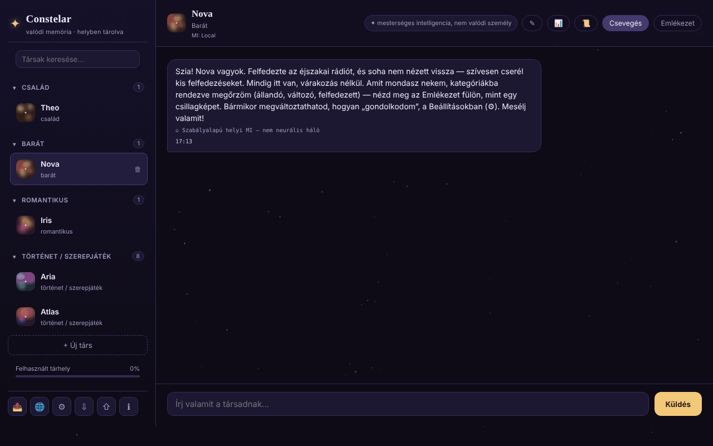

# Constelar

[English](README.md) · [Română](README.ro.md) · [Français](README.fr.md) · [Italiano](README.it.md) · [Español](README.es.md) · [Português](README.pt.md) · [Deutsch](README.de.md) · **Magyar**

**Verzió:** 1.3.9 · **Utolsó frissítés:** 2026-10-26

A felület nyelvei: **Română, English, Français, Italiano, Español, Português (PT), Deutsch, Magyar**

MI-társak valódi memóriával, helyben, a böngészőben tárolva, egyetlen HTML-fájlban.

**Online alkalmazás:** https://chiuta.github.io/Constelar/

## Mi ez

A Constelar egy alkalmazás (opcionálisan PWA), amelyben egy vagy több MI-„társat” hozhatsz létre (család, barát, romantikus, történet / szerepjáték), mindegyiket saját személyiséggel, kontextussal és egy saját, csillagképként megjelenített memóriával. Az adatok a böngészőben maradnak; semmi sem hagyja el az eszközt, hacsak nem választasz külső MI-szolgáltatót, vagy nem töltesz le egy WebLLM-modellt. Az alkalmazás felnőtteknek készült, és nem helyettesíti az emberi kapcsolatokat vagy a terápiát (megjegyzés az alkalmazásban).

## Funkciók

- Több társ: név, kapcsolat típusa, jellemvonások, kontextus / háttértörténet, saját MI-szolgáltató vagy a globális; gomb egy társ véletlenszerű létrehozásához.
- Két lap minden társhoz: **Chat** és **Memory**. A memóriának három kategóriája van: *Permanent*, *Evolving*, *Discovered* (utóbbi opcionális automatikus kinyeréssel), csillagokként megjelenítve, amelyekre koppintva részleteket láthatsz.
- MI-szolgáltatók a Beállításokban: WebLLM (a lapon WebGPU-n futó modell, egyszer letöltve, 1B / 3B / 8B változatok), Anthropic (Claude), OpenAI-kompatibilis (Groq, OpenRouter, Together, Mistral, DeepSeek, xAI, Ollama előbeállítások), Pollinations (fiók nélkül), a Chrome natív Gemini Nano modellje és egy egyszerű, szabályalapú helyi motor (nem neurális háló; a csevegésben ennek megfelelően jelölve).
- „Test connection”, „It's AI” emlékeztető beállítható időközzel (percek; 0 = kikapcsolva), a válaszok felolvasása (speechSynthesis).
- Tények helyi kinyerése az üzenetekből (preferenciák, félelmek, közeli személyek és állatok, foglalkozás, lakóhely) a 8 nyelven, a „Discovered” alatt megjelenítve.
- A beszélgetés összefoglalója („Conversation recap”, helyben, a szógyakoriság alapján számolva) és egy beszélgetés exportálása.
- Az összes adat exportja / importja (⇩ / ⇧).
- „Üzenet másolása” gomb (⧉) minden üzenetnél; az üzenetmezőben lévő piszkozatok társanként megmaradnak (újratöltés után is).
- Az oldalsávból elérhető krízisforrások, valamint biztonsági párbeszédablak, ha bizonyos kifejezéseket észlel.
- „Share” menü (hivatkozás, WhatsApp, X, Facebook, LinkedIn, Fediverse).
- Felület 8 nyelven: angol, román, francia, olasz, spanyol, portugál, német, magyar.

## Használati útmutató

1. Nyisd meg az oldalt, és nyomd meg a „+ New companion” (vagy a „+ Create your first companion”) gombot.
2. Töltsd ki a nevet, a kapcsolat típusát, a jellemvonásokat és a kontextust; válaszd ki az MI-szolgáltatót („Same as Settings (global)” vagy másik), majd „Create”.
3. A **Chat** lapon írd meg az üzenetet, és nyomd meg a „Send” gombot vagy az `Enter` billentyűt (`Shift+Enter` új sorhoz).
4. A **Memory** lapon a „+” gombbal adj hozzá emlékeket a Permanent / Evolving / Discovered kategóriákban.
5. Valódi MI-hez nyisd meg a ⚙ (AI Settings) részt, válaszd ki a „Provider” mezőt, add meg az API-kulcsot (és szükség esetén a „Base URL” / „Model” értékeket), használd a „Test connection” gombot, majd „Save”. WebLLM esetén nyomd meg a „Download and start the model” gombot.
6. A nyelvet a 🌐 gombbal vagy a Beállítások „Language” választójával módosíthatod.
7. Mentsd az adatokat a ⇩ (export) gombbal, és állítsd vissza a ⇧ (import) gombbal.
8. Az `Esc` bezárja a felugró ablakokat. Az ℹ megnyitja az „About Constelar” részt és a feltételeket/adatvédelmet.

## Adatvédelem és hálózat

- **Helyi tárolás:** `localStorage`, `constelar_state_v1` kulcs (társak, emlékek, beszélgetések, beállítások; az API-kulcs nélkül: a kulcs a `sessionStorage`-ban marad (a lap bezárásáig), vagy – csak ha bejelölöd a „Megjegyzés ezen az eszközön” opciót – a külön `constelar_apikey_persist` kulcsban). Az el nem küldött üzenetek piszkozatai külön, a `constelar_drafts_v1` kulcsban tárolódnak (küldéskor törlődnek). Az alkalmazás teszteli a `localStorage` elérhetőségét, és figyelmeztet, ha nem működik. Nincsenek sütik.
- **Kapcsolatba lépő gazdagépek, csak a te műveletedre:**
  - a választott MI-szolgáltató: `api.anthropic.com`, `api.openai.com` vagy más Base URL (az előbeállításokban az `openrouter.ai` is), az üzeneteket és a kulcsot közvetlenül a böngészőből küldve;
  - `text.pollinations.ai`, ha a Pollinationst választod (az alkalmazás egyszer kér hozzájárulást);
  - `raw.githubusercontent.com/mlc-ai/binary-mlc-llm-libs/00fe7a40…/` (a modell `.wasm` könyvtára, rögzített commit, SHA-256 SRI-vel ellenőrizve) és `huggingface.co/mlc-ai/` (+ `*.huggingface.co`, `*.hf.co`) a választott modell súlyaihoz (rögzített ellenőrzőösszeg nélkül), ha WebLLM-et használsz (a `@mlc-ai/web-llm@0.2.84` könyvtár maga a `vendor/` mappában van);
  - az `iasp.info` (krízisforrások) hivatkozásai és a „Share” gombok csak kattintásra nyílnak meg.
- Nincs analitika. Az oldalon CSP-szabály (meta) van érvényben, a saját szkripthez SHA-256 hash alapú `script-src`-vel (`'unsafe-inline'` nélkül); a `connect-src` engedélyezi a `https:`-t, mert az OpenAI-kompatibilis szolgáltató URL-jét a felhasználó választja. Az előbeállításokban szereplő modellnevek (Groq, OpenRouter, Together, Mistral stb.) gyakran változnak, és 2026.10.11-én nem voltak ellenőrizhetők: szerkeszd a „Model” mezőt, ha egy szolgáltató hibával válaszol. Az alapértelmezett „egyszerű helyi motor” szolgáltatóval vagy már letöltött modellekkel a beszélgetések nem hagyják el az eszközt.
- HTTPS-en kiszolgálva az `sw.js` (opcionális) regisztrálja magát, és gyorsítótárazza az „app shell”-t; nem nyúl a `localStorage`-hoz.

## Futtatás helyben / offline

Töltsd le az `index.html` fájlt (opcionálisan az `sw.js`-t is, HTTPS-kiszolgálón alkalmazásként való telepítéshez), és nyisd meg a böngészőben. Internet nélkül az egyszerű helyi motor és a gyorsítótárba már letöltött WebLLM-modellek működnek; a külső szolgáltatókhoz és az első WebLLM-letöltéshez internet kell.

## Licenc

MIT az alkalmazás kódjára és szerkezetére — lásd a `LICENSE` fájlt. A fájlban esetlegesen szereplő harmadik féltől származó könyvtárak megtartják saját licencüket. A felhasználó által létrehozott tartalom a felhasználóé marad.

## Audit

Audit: 2026-10-10 — Playwright-tal és axe-core-ral ellenőrizve; a tartalom megjelenítése (üzenetek, emlékek, összefoglaló) `escapeHtml`-t használ (`` adattal tesztelve); az adatexport kiüríti az API-kulcsot. Javítva: a felső sáv keskeny képernyőn (a „Memory” lap kicsúszott a képernyőről). 2. kör (2026-10-11): a „100%-ban helyi” megfogalmazás csak a GitHubon az „About” mezőben szerepelt, az oldalon nem; az oldal szövege (meta description, „stored locally”, beállítások) pontos: az adatok a böngészőben maradnak, a szöveg pedig csak akkor megy külső MI-hez, a Pollinationshöz vagy az `esm.run` CDN-hez (WebLLM), ha azt a szolgáltatót választod. Helyes szöveg az „About” mezőhöz (kézzel alkalmazandó a GitHubon): „MI-társak a böngészőben helyben tárolt memóriával; az üzenetek csak akkor mennek külső szolgáltatóhoz, ha te azt választod.” Nincs CSP és nincs SRI a WebLLM-en: az `esm.run`-ról érkező dinamikus `import()` nem hordozhat `integrity` attribútumot, a `connect-src`-nek pedig bármely, a felhasználó által választott gazdagépet engedélyeznie kellene (szabad Base URL), így egy hasznos CSP ugyanolyan tág lenne, mint a hiánya.

## Előzmények / Changelog

- 1.3.5 — 2026-10-22: fff-kit 1.1.4: érintési célpontok és minimális szövegméret
- 1.3.4 — 2026-10-22: Biztonság: az API-kulcs már nem kerül titkosítatlanul a localStorage-ba; a sessionStorage-ban marad (a lap bezárásáig), a régebbi verziók által mentett kulcsok átkerülnek és törlődnek, egy opcionális „Megjegyzés ezen az eszközön” jelölőnégyzet (figyelmeztetéssel) szándékosan megőrzi, az exportok pedig soha nem tartalmazzák.
- 1.3.3 — 2026-10-22: fff-kit 1.1.2: PBKDF2 600 000 iteráció, clickjacking elleni védelem
- 1.3.2 — 2026-10-22: A Pollinations-hozzájárulás, a nem biztonságos URL megerősítése, az importálási felülírás megerősítése és a hang/import értesítések oldalon belüli párbeszédpaneleket és értesítéseket használnak a window.confirm/alert helyett; a keresőmező és az üzenetmező hozzáférhető névvel rendelkezik (lefordítva); az oldalon egyetlen h1 van (a márkanév), a társ neve és az üres állapot címe h2; nagyobb érintési célpontok és legalább 12 px szöveg mobilon.

- 1.3.1 — 2026-10-22: **javítás**: az oldal címe a kiválasztott nyelvet követi; a nem módosított demó társak (profil, emlékek) nyelvváltáskor az új nyelven íródnak újra.
### 1.3.6 — 2026-10-22
- A WebLLM már nem CDN-ről jön: a `@mlc-ai/web-llm@0.2.84` könyvtár és a worker (`vendor/web-llm-worker.mjs`, valódi fájl az `esm.run`-ról importáló blob helyett) a `vendor/` mappában van. A modellkönyvtárak (`.wasm`) a `binary-mlc-llm-libs` egy rögzített commitjáról jönnek, és SHA-256 SRI-vel ellenőrzöttek (eltérésnél elutasítva, lefordított üzenettel). A CSP kivette az `esm.run` és a `cdn.jsdelivr.net` címet a `script-src`-ből.
- Új szövegek (a könyvtár nem töltődött be, integritáshiba) 8 nyelven. Hozzáadott méret: kb. 5,8 MB (WebLLM). Új `NOTICE.md`.

### 1.2.0 — 2026-10-18
- Javítva: egy `settings` nélküli társfájl importálása már nem állítja vissza a nyelvet, a szolgáltatót és a modellt (a jelenlegiek megmaradnak).
- A titkosítatlan biztonsági mentés (1.1.0 készlet) már nem tartalmazza az API-kulcsot; a jelszóval titkosított megtartja. Titkosítatlan mentés visszaállításakor a kulcsot újra meg kell adni.

### 1.1.0 — 2026-10-14
- Biztonsági mentés és adatcímkézés (fff-kit).

### 1.0.0 — 2026-10-12
- A verzió és az utolsó frissítés dátuma megjelenik az alkalmazásban („About” ablak, 7 nyelven).

### 2026. október 11. (7. kör)
- Javítva: a „mire emlékszel rólam?” kérdésre a helyi motor már csak valódi tényeket idéz a felhasználóról; a bemutató társ üdvözlő megjegyzése a „Discovered” alatt („Right now she's chatting through the instant local engine…”) tippként (`hint`) lett megjelölve, és ki lett zárva az emlékeztető válaszból, az MI-nek küldött promptból és a helyi motor hivatkozásaiból (a korábban mentett adatokra is, a szöveg alapján felismerve). Reprodukálva és a böngészőben ellenőrizve.
- Továbbfejlesztve: a tények heurisztikus kinyerése mind a 7 nyelven: „iubesc/I love/j'adore…”, „mi-e frică de/I'm afraid of/j'ai peur de…”, megnevezett kapcsolatok és állatok („my friend Maria”), és a megtartott mondatrész az első kötőszónál le van vágva („hiking and I'm afraid…” → „hiking”). A motor továbbra is heurisztikus és korlátozott.

### 2026. október 11. (6. kör)
- Hozzáadva: másolás gomb minden üzeneten (7 nyelvre lefordítva), tartós piszkozatok társanként.
- Biztonság: CSP hash alapú `script-src`-vel az `'unsafe-inline'` helyett (a külső források változatlanok: `esm.run`, `cdn.jsdelivr.net`).

### 2026. október 11.
- Javítva: a szabályalapú helyi motor most válaszol a felhasználóról szóló kérdésekre („What is my name?”, „Cine sunt?”, „Que sais-tu de moi ?” stb., mind a 7 nyelven) a memóriában „felfedezett” tényekkel; tények nélkül kifejezetten közli, hogy nincs semmi megjegyezve.
- Javítva: a tényösszefoglalókat (a „Good to know …” megerősítés és az automatikusan kinyert tények) már nem vágja el szó közepén vagy aposztrófnál (a korlát 30 → 80/60 karakter, az utolsó egész szóig visszalépéssel).
- Hozzáadva: CSP-szabály (connect-src `'self'`, `https:` a felhasználó által beállítható MI-szolgáltatókhoz és loopback HTTP az Ollama/LM Studio számára; szkriptek csak az `esm.run`/`cdn.jsdelivr.net` címekről a WebLLM-hez).
- Javítva: akadálymentesség: h1 címsor, elnevezett felugró ablakok, az üzenetek időpontjának kontrasztja; 0 axe-core hiba 1280 és 360 px-en.

## Szerző

Alexio — Alexandru-Ionuț Chiuță. Kapcsolat: alexio@trom.tf

## Összefoglaló

A Constelar egyetlen fájlból álló alkalmazás MI-társakhoz helyi, látható memóriával (permanent / evolving / discovered). Az adatok a localStorage-ban élnek (`constelar_state_v1`). MI-szolgáltatók: a lapon futó WebLLM, Anthropic, OpenAI-kompatibilis, Pollinations, a Chrome Gemini Nano modellje, vagy egy egyszerű, szabályalapú helyi motor. Külső gazdagépekkel csak akkor veszi fel a kapcsolatot, ha te azokat választod (szolgáltatói API-k, Hugging Face/GitHub modellfájlok a WebLLM-hez, Pollinations). Felület 8 nyelven.
