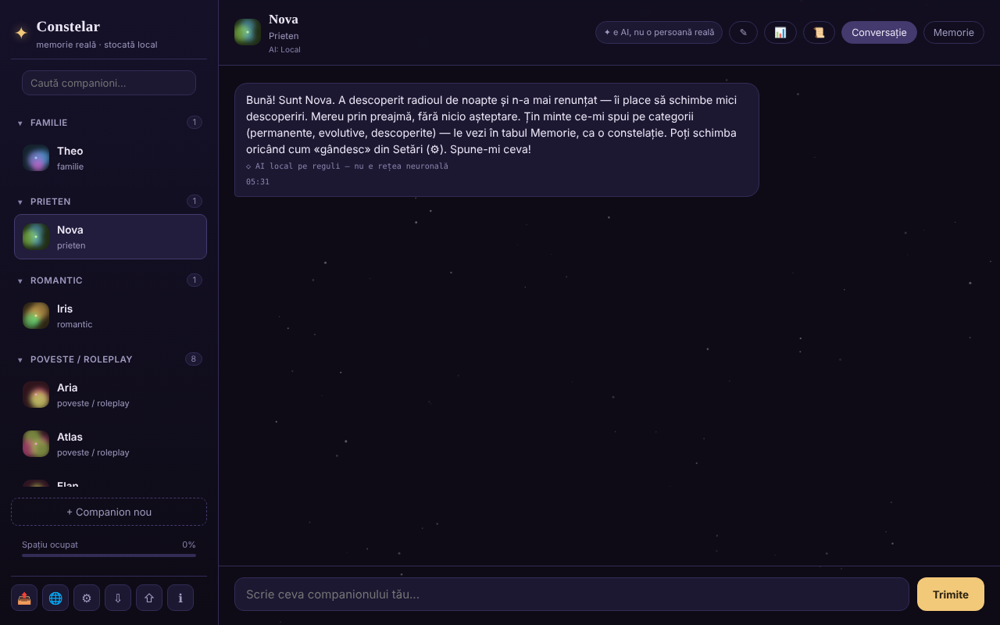

# Constelar

**English** · [Română](README.ro.md) · [Français](README.fr.md) · [Italiano](README.it.md) · [Español](README.es.md) · [Português](README.pt.md) · [Deutsch](README.de.md) · [Magyar](README.hu.md)

**Version:** 1.3.0 · **Last updated:** 2026-10-19

Interface languages: **Română, English, Français, Italiano, Español, Português (PT), Deutsch, Magyar**

AI companions with real memory, stored locally in the browser, in a single HTML file.

**Live app:** https://chiuta.github.io/Constelar/

## What it is

Constelar is an app (optionally a PWA) in which you create one or more AI "companions" (family, friend, romantic, story / roleplay), each with its own personality, context and a memory of its own visualised as a constellation. The data stays in the browser; nothing leaves the device unless you choose an external AI provider or download a WebLLM model. The app is designed for adults and does not replace human relationships or therapy (note in the app).

## Features

- Multiple companions: name, relationship type, traits, context / backstory, own AI provider or the global one; a button to generate a companion at random.
- Two tabs for each companion: **Chat** and **Memory**. The memory has three categories: *Permanent*, *Evolving*, *Discovered* (the latter with optional auto-extraction), displayed as stars that you can tap for details.
- AI providers in Settings: WebLLM (a model run in the tab through WebGPU, downloaded once, 1B / 3B / 8B variants), Anthropic (Claude), OpenAI-compatible (presets Groq, OpenRouter, Together, Mistral, DeepSeek, xAI, Ollama), Pollinations (no account), Chrome's native Gemini Nano and a simple rule-based local engine (not a neural network; labelled as such in the chat).
- "Test connection", "It's AI" reminder at a configurable interval (minutes; 0 = off), reading the replies aloud (speechSynthesis).
- Local extraction of facts from messages (preferences, fears, close people and animals, occupation, home) in the 8 languages, displayed in "Discovered".
- Conversation summary ("Conversation recap", computed locally by word frequency) and export of a conversation.
- Export / import of all the data (⇩ / ⇧).
- "Copy message" button (⧉) on every message; drafts in the message field are kept per companion (and after reload).
- Crisis resources accessible from the sidebar and a safety dialog when certain expressions are detected.
- "Share" menu (link, WhatsApp, X, Facebook, LinkedIn, Fediverse).
- Interface in 8 languages: English, Romanian, French, Italian, Spanish, Portuguese, German, Hungarian.

## User guide

1. Open the page and press "+ New companion" (or "+ Create your first companion").
2. Fill in the name, relationship type, traits and context; choose the AI provider ("Same as Settings (global)" or another), then "Create".
3. In the **Chat** tab write the message and press "Send" or `Enter` (`Shift+Enter` for a new line).
4. In the **Memory** tab add memories with "+" in the categories Permanent / Evolving / Discovered.
5. For a real AI, open ⚙ (AI Settings), choose "Provider", enter the API key (and, if needed, "Base URL" / "Model"), use "Test connection", then "Save". For WebLLM press "Download and start the model".
6. Change the language from the 🌐 button or from the "Language" selector in Settings.
7. Save the data with ⇩ (export) and restore it with ⇧ (import).
8. `Esc` closes the modal windows. ℹ opens "About Constelar" and the terms/privacy.

## Privacy and network

- **Local storage:** `localStorage`, key `constelar_state_v1` (companions, memories, conversations, settings; including the API key if you enter it). Drafts of unsent messages are kept separately, in the key `constelar_drafts_v1` (deleted on sending). The app tests the availability of `localStorage` and warns if it does not work. No cookies.
- **Hosts contacted, only on your action:**
  - the chosen AI provider: `api.anthropic.com`, `api.openai.com` or another Base URL (including `openrouter.ai` in the presets), with the messages and the key sent directly from the browser;
  - `text.pollinations.ai`, if you choose Pollinations (the app asks for consent once);
  - `esm.run` (CDN), for loading the library `@mlc-ai/web-llm@0.2.84`, and then downloading the chosen model, if you use WebLLM;
  - the links to `iasp.info` (crisis resources) and the "Share" buttons open only on click.
- No analytics. The page has a CSP policy (meta), with `script-src` by SHA-256 hash for its own script (no `'unsafe-inline'`); `connect-src` allows `https:` because the URL of the OpenAI-compatible provider is chosen by the user. The model names in the presets (Groq, OpenRouter, Together, Mistral, etc.) change often and could not be verified on 11.10.2026: edit the "Model" field if a provider answers with an error. With the default provider "simple local engine" or with models already downloaded, the conversations do not leave the device.
- When served over HTTPS, `sw.js` (optional) registers and caches the "app shell"; it does not touch `localStorage`.

## Running locally / offline

Download `index.html` (optionally also `sw.js`, for installing as an app on an HTTPS server) and open it in the browser. Without internet the simple local engine and the WebLLM models already downloaded to the cache work; external providers and the first WebLLM download require internet.

## License

MIT for the code and structure of the app — see the `LICENSE` file. Any third-party libraries included in the file keep their own licenses. Content created by the user remains theirs.

## Audit

Audit: 2026-10-10 — verified with Playwright and axe-core; content rendering (messages, memories, summary) uses `escapeHtml` (tested with an `` payload); the data export blanks the API key. Fixed: the top bar on a narrow screen (the "Memory" tab went off-screen). Round 2 (2026-10-11): the wording "100% local" appeared only in the "About" field on GitHub, not on the page; the page text (meta description, "stored locally", settings) is accurate: the data stays in the browser, and the text goes to an external AI, to Pollinations or to the `esm.run` CDN (WebLLM) only if you choose that provider. Correct text for "About" (to be applied manually on GitHub): "AI companions with memory stored locally in the browser; messages go to an external provider only if you choose it." No CSP and no SRI on WebLLM: the dynamic `import()` from `esm.run` cannot carry an `integrity` attribute, and `connect-src` would have to allow any host chosen by the user (free Base URL), so a useful CSP would be as wide as having none.

## History / Changelog

### 1.2.0 — 2026-10-18
- Fixed: importing a companions file without `settings` no longer resets the language, provider and model (the current ones stay).
- The unencrypted backup (kit 1.1.0) no longer contains the API key; the password-encrypted one keeps it. When restoring an unencrypted backup, the key is re-entered.

### 1.1.0 — 2026-10-14
- Backup and data labelling (fff-kit).

### 1.0.0 — 2026-10-12
- The version and the date of the last update are shown in the app ("About" window, in 7 languages).

### 11 October 2026 (round 7)
- Fixed: for "what do you remember about me?" the local engine now quotes only real facts about the user; the welcome note of the demo companion in "Discovered" ("Right now she's chatting through the instant local engine…") was marked as a hint (`hint`) and excluded from the recall answer, from the prompt sent to the AI and from the local engine's references (including for data saved earlier, recognised by its text). Reproduced and verified in the browser.
- Improved: heuristic fact extraction, in all 7 languages: "iubesc/I love/j'adore…", "mi-e frică de/I'm afraid of/j'ai peur de…", named relations and animals ("my friend Maria"), and the retained phrase is cut at the first conjunction ("hiking and I'm afraid…" → "hiking"). The engine remains heuristic and limited.

### 11 October 2026 (round 6)
- Added: copy button on every message (translated into 7 languages), persistent drafts per companion.
- Security: CSP with `script-src` by hash instead of `'unsafe-inline'` (external sources unchanged: `esm.run`, `cdn.jsdelivr.net`).

### 11 October 2026
- Fixed: the rule-based local engine now answers questions about the user ("What is my name?", "Cine sunt?", "Que sais-tu de moi ?", etc., in all 7 languages) with the "discovered" facts from memory; without facts, it says explicitly that it has nothing remembered.
- Fixed: fact summaries (the "Good to know …" confirmation and the automatically extracted facts) are no longer cut in the middle of a word or at an apostrophe (limit 30 → 80/60 characters, with fallback to the last whole word).
- Added: CSP policy (connect-src `'self'`, `https:` for user-configurable AI providers and loopback HTTP for Ollama/LM Studio; scripts only from `esm.run`/`cdn.jsdelivr.net` for WebLLM).
- Fixed: accessibility: h1 heading, named modal windows, contrast for message time; 0 axe-core violations at 1280 and 360 px.

## Author

Alexio — Alexandru-Ionuț Chiuță. Contact: alexio@trom.tf

## Summary

Constelar is a single-file app for AI companions with local, visible memory (permanent / evolving / discovered). Data lives in localStorage (`constelar_state_v1`). AI providers: in-tab WebLLM, Anthropic, OpenAI-compatible, Pollinations, Chrome's Gemini Nano, or a simple rule-based local engine. External hosts are contacted only when you pick them (provider APIs, esm.run CDN for WebLLM, Pollinations). UI in 8 languages.
