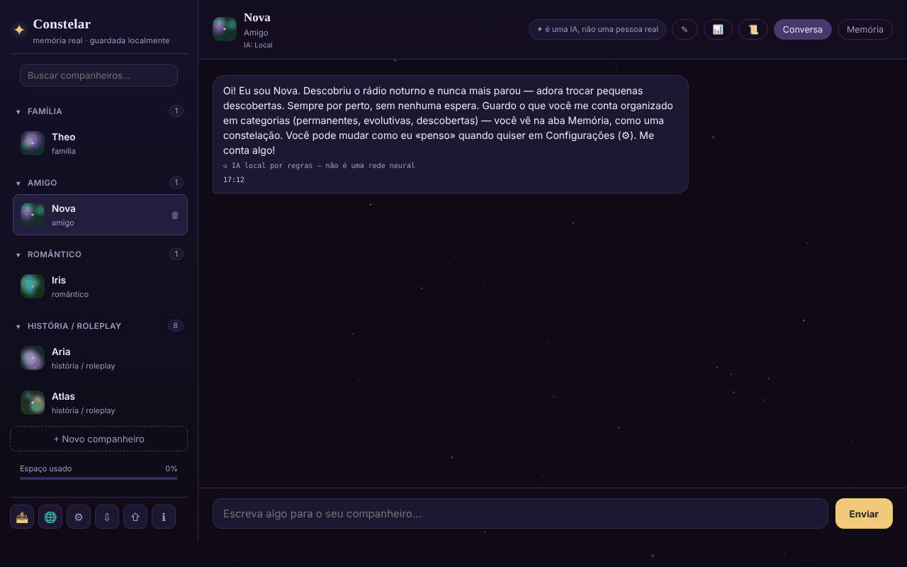

# Constelar

[English](README.md) · [Română](README.ro.md) · [Français](README.fr.md) · [Italiano](README.it.md) · [Español](README.es.md) · **Português** · [Deutsch](README.de.md) · [Magyar](README.hu.md)

**Versão:** 2.0.1 · **Última atualização:** 2026-10-27

Idiomas da interface: **Română, English, Français, Italiano, Español, Português (PT), Deutsch, Magyar**

Companheiros de IA com memória real, armazenada localmente no navegador, num único ficheiro HTML.

**Aplicação online:** https://chiuta.github.io/Constelar/

## O que é

O Constelar é uma aplicação (PWA opcional) em que cria um ou vários «companheiros» de IA (família, amigo, romântico, história / roleplay), cada um com personalidade, contexto e uma memória própria visualizada como uma constelação. Os dados ficam no navegador; nada sai do dispositivo, a não ser que escolha um fornecedor de IA externo ou descarregue um modelo WebLLM. A aplicação foi concebida para adultos e não substitui as relações humanas nem a terapia (nota na aplicação).

## Funcionalidades

- Vários companheiros: nome, tipo de relação, traços, contexto / história de fundo, fornecedor de IA próprio ou o global; botão para gerar um companheiro aleatoriamente.
- Dois separadores para cada companheiro: **Chat** e **Memory**. A memória tem três categorias: *Permanent*, *Evolving*, *Discovered* (esta última com extração automática opcional), apresentadas como estrelas em que pode tocar para ver detalhes.
- Fornecedores de IA nas Definições: WebLLM (modelo executado no separador através de WebGPU, descarregado uma vez, variantes 1B / 3B / 8B), Anthropic (Claude), compatível com OpenAI (predefinições Groq, OpenRouter, Together, Mistral, DeepSeek, xAI, Ollama), Pollinations (sem conta), Gemini Nano nativo do Chrome e um motor local simples baseado em regras (não é uma rede neuronal; etiquetado como tal no chat).
- «Test connection», lembrete «It's AI» a intervalo configurável (minutos; 0 = desativado), leitura em voz alta das respostas (speechSynthesis).
- Extração local de factos a partir das mensagens (preferências, medos, pessoas e animais próximos, ocupação, habitação) nas 8 línguas, apresentados em «Discovered».
- Resumo da conversa («Conversation recap», calculado localmente pela frequência das palavras) e exportação de uma conversa.
- Exportação / importação de todos os dados (⇩ / ⇧).
- Botão «Copiar a mensagem» (⧉) em cada mensagem; os rascunhos do campo de mensagem são guardados por companheiro (e após recarregar).
- Recursos de crise acessíveis a partir da barra lateral e diálogo de segurança quando são detetadas certas expressões.
- Menu «Share» (ligação, WhatsApp, X, Facebook, LinkedIn, Fediverso).
- Interface em 8 línguas: inglês, romeno, francês, italiano, espanhol, português, alemão, húngaro.

## Manual de utilização

1. Abra a página e prima «+ New companion» (ou «+ Create your first companion»).
2. Preencha o nome, o tipo de relação, os traços e o contexto; escolha o fornecedor de IA («Same as Settings (global)» ou outro) e depois «Create».
3. No separador **Chat** escreva a mensagem e prima «Send» ou `Enter` (`Shift+Enter` para nova linha).
4. No separador **Memory** adicione memórias com «+» nas categorias Permanent / Evolving / Discovered.
5. Para uma IA real, abra ⚙ (AI Settings), escolha «Provider», introduza a chave API (e, se for caso disso, «Base URL» / «Model»), use «Test connection» e depois «Save». Para o WebLLM prima «Download and start the model».
6. Mude a língua no botão 🌐 ou no seletor «Language» das Definições.
7. Guarde os dados com ⇩ (exportar) e restaure-os com ⇧ (importar).
8. `Esc` fecha as janelas modais. ℹ abre «About Constelar» e os termos/a privacidade.

## Privacidade e rede

- **Armazenamento local:** `localStorage`, chave `constelar_state_v1` (companheiros, memórias, conversas, definições; sem a chave API: a chave fica em `sessionStorage` (até fechar o separador) ou, só se marcar «Lembrar neste dispositivo», na chave separada `constelar_apikey_persist`). Os rascunhos de mensagens não enviadas ficam guardados em separado, na chave `constelar_drafts_v1` (eliminados ao enviar). A aplicação testa a disponibilidade do `localStorage` e avisa se não funcionar. Sem cookies.
- **Anfitriões contactados, apenas por ação sua:**
  - o fornecedor de IA escolhido: `api.anthropic.com`, `api.openai.com` ou outro Base URL (incluindo `openrouter.ai` nas predefinições), com as mensagens e a chave enviadas diretamente do navegador;
  - `text.pollinations.ai`, se escolher o Pollinations (a aplicação pede o consentimento uma única vez);
  - `raw.githubusercontent.com/mlc-ai/binary-mlc-llm-libs/00fe7a40…/` (a biblioteca do modelo `.wasm`, commit fixo, verificada com SRI SHA-256) e `huggingface.co/mlc-ai/` (+ `*.huggingface.co`, `*.hf.co`) para os pesos do modelo escolhido (sem hash fixo), se utilizar o WebLLM (a biblioteca `@mlc-ai/web-llm@0.2.84` em si está em `vendor/`);
  - as ligações para `iasp.info` (recursos de crise) e os botões «Share» abrem-se apenas ao clicar.
- Sem ferramentas de análise. A página tem uma política CSP (meta), com `script-src` por hash SHA-256 para o script próprio (sem `'unsafe-inline'`); `connect-src` permite `https:` porque o URL do fornecedor compatível com OpenAI é escolhido pelo utilizador. Os nomes dos modelos nas predefinições (Groq, OpenRouter, Together, Mistral, etc.) mudam com frequência e não puderam ser verificados a 11.10.2026: edite o campo «Model» se um fornecedor responder com um erro. Com o fornecedor predefinido «motor local simples» ou com modelos já descarregados, as conversas não saem do dispositivo.
- Quando servido por HTTPS, o `sw.js` (opcional) regista-se e guarda em cache o «app shell»; não toca no `localStorage`.

## Execução local / offline

Descarregue `index.html` (opcionalmente também `sw.js`, para instalar como aplicação num servidor HTTPS) e abra-o no navegador. Sem internet funcionam o motor local simples e os modelos WebLLM já descarregados para a cache; os fornecedores externos e a primeira descarga do WebLLM exigem internet.

## Licença

MIT para o código e a estrutura da aplicação — veja o ficheiro `LICENSE`. As eventuais bibliotecas de terceiros incluídas no ficheiro mantêm as suas próprias licenças. O conteúdo criado pelo utilizador continua a ser seu.

## Auditoria

Auditoria: 2026-10-10 — verificado com Playwright e axe-core; as renderizações de conteúdo (mensagens, memórias, resumo) usam `escapeHtml` (testado com um payload ``); a exportação de dados esvazia a chave API. Corrigido: a barra superior em ecrã estreito (o separador «Memory» saía do ecrã). Ronda 2 (2026-10-11): a formulação «100% local» aparecia apenas no campo «About» do GitHub, não na página; o texto da página (meta description, «stored locally», definições) é exato: os dados ficam no navegador, e o texto segue para uma IA externa, para o Pollinations ou para a CDN `esm.run` (WebLLM) apenas se escolher esse fornecedor. Texto correto para «About» (a aplicar manualmente no GitHub): «Companheiros de IA com memória armazenada localmente no navegador; as mensagens seguem para um fornecedor externo apenas se o escolher.» Sem CSP nem SRI no WebLLM: o `import()` dinâmico a partir de `esm.run` não pode ter o atributo `integrity`, e o `connect-src` teria de permitir qualquer anfitrião escolhido pelo utilizador (Base URL livre), pelo que uma CSP útil seria tão ampla quanto a sua ausência.

## Histórico / Changelog

- 1.3.5 — 2026-10-22: fff-kit 1.1.4: alvos de toque e tamanho mínimo do texto
- 1.3.4 — 2026-10-22: Segurança: a chave API deixou de ser guardada em claro no localStorage; fica no sessionStorage (até fechar o separador), as chaves guardadas por versões anteriores são migradas e apagadas, uma caixa opcional «Lembrar neste dispositivo» (com aviso) mantém-na de propósito, e as exportações nunca a incluem.
- 1.3.3 — 2026-10-22: fff-kit 1.1.2: PBKDF2 600 000 iterações, proteção anti-clickjacking
- 1.3.2 — 2026-10-22: O consentimento do Pollinations, a confirmação de URL não segura, a confirmação de substituição na importação e os avisos de voz/importação usam diálogos e avisos integrados em vez de window.confirm/alert; o campo de pesquisa e a caixa de mensagem têm nomes acessíveis (traduzidos); um único h1 na página (a marca), o nome do companheiro e o título do estado vazio são h2; áreas táteis maiores e texto ≥ 12 px em telemóvel.

- 1.3.1 — 2026-10-22: **correção**: o título da página segue o idioma escolhido; os companheiros de demonstração não modificados (perfil, memórias) são reescritos no novo idioma ao mudar de idioma.
### 1.3.6 — 2026-10-22
- O WebLLM já não vem de uma CDN: a biblioteca `@mlc-ai/web-llm@0.2.84` e o worker (`vendor/web-llm-worker.mjs`, um ficheiro real em vez de um blob que importava de `esm.run`) estão em `vendor/`. As bibliotecas de modelo (`.wasm`) vêm de um commit fixo de `binary-mlc-llm-libs` e são verificadas com SRI SHA-256 (recusadas se diferirem, com mensagem traduzida). A CSP retira `esm.run` e `cdn.jsdelivr.net` de `script-src`.
- Textos novos (biblioteca não carregada, falha de integridade) em 8 línguas. Tamanho adicionado: ~5,8 MB (WebLLM). Novo `NOTICE.md`.

### 1.2.0 — 2026-10-18
- Corrigido: a importação de um ficheiro de companheiros sem `settings` já não repõe a língua, o fornecedor e o modelo (mantêm-se os atuais).
- A cópia de segurança não cifrada (kit 1.1.0) já não contém a chave API; a cifrada com palavra-passe mantém-na. Ao restaurar uma cópia não cifrada, a chave é reintroduzida.

### 1.1.0 — 2026-10-14
- Cópia de segurança e etiquetagem de dados (fff-kit).

### 1.0.0 — 2026-10-12
- A versão e a data da última atualização são apresentadas na aplicação (janela «About», em 7 línguas).

### 11 de outubro de 2026 (ronda 7)
- Corrigido: perante «o que recordas sobre mim?» o motor local cita agora apenas factos reais sobre o utilizador; a nota de boas-vindas do companheiro de demonstração em «Discovered» («Right now she's chatting through the instant local engine…») foi marcada como indício (`hint`) e excluída da resposta de recordação, do prompt enviado à IA e das referências do motor local (incluindo para dados guardados antes, reconhecida pelo texto). Reproduzido e verificado no navegador.
- Melhorado: extração heurística de factos, nas 7 línguas: «iubesc/I love/j'adore…», «mi-e frică de/I'm afraid of/j'ai peur de…», relações e animais com nome («my friend Maria»), e a frase retida é cortada na primeira conjunção («hiking and I'm afraid…» → «hiking»). O motor continua heurístico e limitado.

### 11 de outubro de 2026 (ronda 6)
- Adicionado: botão de cópia em cada mensagem (traduzido em 7 línguas), rascunhos persistentes por companheiro.
- Segurança: CSP com `script-src` por hash em vez de `'unsafe-inline'` (fontes externas inalteradas: `esm.run`, `cdn.jsdelivr.net`).

### 11 de outubro de 2026
- Corrigido: o motor local baseado em regras responde agora a perguntas sobre o utilizador («What is my name?», «Cine sunt?», «Que sais-tu de moi ?», etc., nas 7 línguas) com os factos «descobertos» na memória; sem factos, diz explicitamente que não tem nada retido.
- Corrigido: os resumos de factos (a confirmação «Good to know …» e os factos extraídos automaticamente) já não são cortados a meio de uma palavra nem no apóstrofo (limite 30 → 80/60 carateres, com recuo até à última palavra inteira).
- Adicionado: política CSP (connect-src `'self'`, `https:` para os fornecedores de IA configuráveis pelo utilizador e HTTP loopback para Ollama/LM Studio; scripts apenas de `esm.run`/`cdn.jsdelivr.net` para o WebLLM).
- Corrigido: acessibilidade: título h1, janelas modais com nome, contraste da hora das mensagens; 0 violações axe-core a 1280 e 360 px.

## Autor

Alexio — Alexandru-Ionuț Chiuță. Contacto: alexio@trom.tf

## Resumo

O Constelar é uma aplicação de ficheiro único para companheiros de IA com memória local e visível (permanent / evolving / discovered). Os dados residem no localStorage (`constelar_state_v1`). Fornecedores de IA: WebLLM no separador, Anthropic, compatível com OpenAI, Pollinations, Gemini Nano do Chrome ou um motor local simples baseado em regras. Os anfitriões externos só são contactados quando os escolhe (APIs dos fornecedores, ficheiros de modelo do Hugging Face/GitHub para o WebLLM, Pollinations). Interface em 8 línguas.
