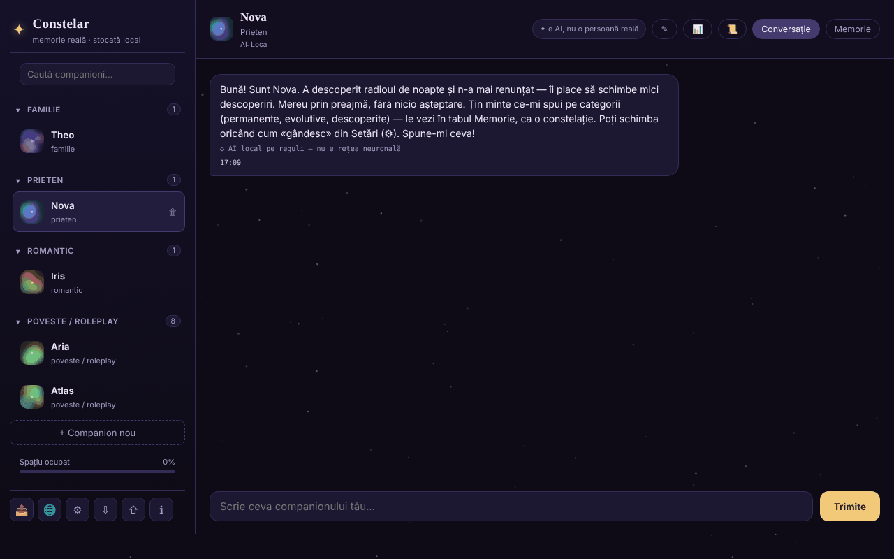

# Constelar

[English](README.md) · **Română** · [Français](README.fr.md) · [Italiano](README.it.md) · [Español](README.es.md) · [Português](README.pt.md) · [Deutsch](README.de.md) · [Magyar](README.hu.md)

**Versiune:** 1.3.7 · **Ultima actualizare:** 2026-10-23

Limbile interfeței: **Română, English, Français, Italiano, Español, Português (PT), Deutsch, Magyar**

Companioni AI cu memorie reală, stocată local în browser, într-un singur fișier HTML.

**Live:** https://chiuta.github.io/Constelar/

## Ce este

Constelar este o aplicație (PWA opțională) în care creați unul sau mai mulți „companioni" AI (familie, prieten, romantic, poveste / roleplay), fiecare cu personalitate, context și o memorie proprie vizualizată ca o constelație. Datele rămân în browser; nimic nu pleacă de pe dispozitiv decât dacă alegeți un furnizor AI extern sau descărcați un model WebLLM. Aplicația este concepută pentru adulți și nu înlocuiește relațiile umane sau terapia (notă din aplicație).

## Funcții

- Companioni multipli: nume, tip de relație, trăsături, context / backstory, furnizor AI propriu sau cel global; buton de generare aleatoare a unui companion.
- Două file pentru fiecare companion: **Chat** și **Memory**. Memoria are trei categorii: *Permanent*, *Evolving*, *Discovered* (aceasta din urmă cu auto-extragere opțională), afișate ca stele pe care le puteți atinge pentru detalii.
- Furnizori AI în Setări: WebLLM (model rulat în tab prin WebGPU, descărcat o dată, variante 1B / 3B / 8B), Anthropic (Claude), compatibil OpenAI (presetări Groq, OpenRouter, Together, Mistral, DeepSeek, xAI, Ollama), Pollinations (fără cont), Gemini Nano nativ din Chrome și un motor local simplu bazat pe reguli (nu este o rețea neurală; etichetat ca atare în chat).
- „Test connection", reamintire „It's AI" la interval configurabil (minute; 0 = oprit), citire cu voce tare a răspunsurilor (speechSynthesis).
- Extragere locală de fapte din mesaje (preferințe, frici, persoane și animale apropiate, ocupație, locuință) în cele 8 limbi, afișate în „Discovered”.
- Rezumat al conversației („Conversation recap", calculat local după frecvența cuvintelor) și export al unei conversații.
- Export / import al tuturor datelor (⇩ / ⇧).
- Buton „Copiază mesajul” (⧉) la fiecare mesaj; ciornele din câmpul de mesaj se păstrează per companion (și după reîncărcare).
- Resurse de criză accesibile din bara laterală și dialog de siguranță când sunt detectate anumite expresii.
- Meniu „Share" (link, WhatsApp, X, Facebook, LinkedIn, Fediverse).
- Interfață în 8 limbi: engleză, română, franceză, italiană, spaniolă, portugheză, germană, maghiară.

## Manual de utilizare

1. Deschideți pagina și apăsați „+ New companion" (sau „+ Create your first companion").
2. Completați numele, tipul relației, trăsăturile și contextul; alegeți furnizorul AI („Same as Settings (global)" sau altul), apoi „Create".
3. În fila **Chat** scrieți mesajul și apăsați „Send" sau `Enter` (`Shift+Enter` pentru rând nou).
4. În fila **Memory** adăugați amintiri cu „+" în categoriile Permanent / Evolving / Discovered.
5. Pentru un AI real, deschideți ⚙ (AI Settings), alegeți „Provider", introduceți cheia API (și, dacă e cazul, „Base URL" / „Model"), folosiți „Test connection", apoi „Save". Pentru WebLLM apăsați „Download and start the model".
6. Schimbați limba din butonul 🌐 sau din selectorul „Language" din Setări.
7. Salvați datele cu ⇩ (export) și le restaurați cu ⇧ (import).
8. `Esc` închide ferestrele modale. ℹ deschide „About Constelar" și termenii/confidențialitatea.

## Confidențialitate și rețea

- **Stocare locală:** `localStorage`, cheia `constelar_state_v1` (companioni, memorii, conversații, setări; fără cheia API: cheia se păstrează în `sessionStorage` (până la închiderea filei) sau, doar dacă bifați „Ține minte pe acest dispozitiv”, în cheia separată `constelar_apikey_persist`). Ciornele mesajelor netrimise se păstrează separat, în cheia `constelar_drafts_v1` (se șterg la trimitere). Aplicația testează disponibilitatea `localStorage` și avertizează dacă nu funcționează. Fără cookie-uri.
- **Hosturi contactate, doar la acțiunea dumneavoastră:**
  - furnizorul AI ales: `api.anthropic.com`, `api.openai.com` sau alt Base URL (inclusiv `openrouter.ai` în presetări), cu mesajele și cheia trimise direct din browser;
  - `text.pollinations.ai`, dacă alegeți Pollinations (aplicația cere acordul o singură dată);
  - `raw.githubusercontent.com/mlc-ai/binary-mlc-llm-libs/00fe7a40…/` (biblioteca modelului `.wasm`, commit fixat, verificată prin SRI SHA-256) și `huggingface.co/mlc-ai/` (+ `*.huggingface.co`, `*.hf.co`) pentru ponderile modelului ales (fără hash fixat), dacă folosiți WebLLM (biblioteca `@mlc-ai/web-llm@0.2.84` este în `vendor/`);
  - linkurile către `iasp.info` (resurse de criză) și butoanele „Share" se deschid doar la clic.
- Fără analitice. Pagina are politică CSP (meta), cu `script-src` pe hash SHA-256 pentru scriptul propriu (fără `'unsafe-inline'`); `connect-src` permite `https:` deoarece URL-ul furnizorului compatibil OpenAI este ales de utilizator. Numele modelelor din presetări (Groq, OpenRouter, Together, Mistral etc.) se schimbă des și nu au putut fi verificate la 11.10.2026: editați câmpul „Model” dacă un furnizor răspunde cu eroare. Cu furnizorul implicit „motor local simplu" sau cu modele deja descărcate, conversațiile nu părăsesc dispozitivul.
- Când este servit prin HTTPS, `sw.js` (opțional) se înregistrează și păstrează în cache „app shell"-ul; nu atinge `localStorage`.

## Rulare locală / offline

Descărcați `index.html` (opțional și `sw.js`, pentru instalare ca aplicație pe un server HTTPS) și deschideți-l în browser. Fără internet funcționează motorul local simplu și modelele WebLLM deja descărcate în cache; furnizorii externi și prima descărcare WebLLM necesită internet.

## Licență

MIT pentru codul și structura aplicației — vezi fișierul `LICENSE`. Eventualele biblioteci terțe incluse în fișier își păstrează licențele proprii. Conținutul creat de utilizator rămâne al acestuia.

## Audit

Audit: 2026-10-10 — verificat cu Playwright și axe-core; randările de conținut (mesaje, memorii, rezumat) folosesc `escapeHtml` (testat cu payload ``); exportul de date golește cheia API. Corectat: bara de sus pe ecran îngust (fila „Memory" ieșea din ecran). Rundă 2 (2026-10-11): formularea „100% locală” apărea doar în câmpul „About” de pe GitHub, nu în pagină; textul paginii (meta description, „stored locally”, setări) este exact: datele rămân în browser, iar textul pleacă spre un AI extern, spre Pollinations sau spre CDN-ul `esm.run` (WebLLM) doar dacă alegeți acel furnizor. Text corect pentru „About” (de aplicat manual pe GitHub): „Companioni AI cu memorie stocată local în browser; mesajele pleacă spre un furnizor extern doar dacă îl alegi tu.” Fără CSP și fără SRI pe WebLLM: `import()` dinamic de pe `esm.run` nu poate purta atribut `integrity`, iar `connect-src` ar trebui să permită orice gazdă aleasă de utilizator (Base URL liber), deci o CSP utilă ar fi la fel de largă ca absența ei.

## Istoric / Changelog

- 1.3.5 — 2026-10-22: fff-kit 1.1.4: ținte tactile și text minim
- 1.3.4 — 2026-10-22: Securitate: cheia API nu se mai salvează în clar în localStorage; se păstrează în sessionStorage (până la închiderea filei), cheile salvate de versiunile vechi se migrează și se șterg, o bifă opțională „Ține minte pe acest dispozitiv” (cu avertisment) o păstrează intenționat, iar exporturile nu o conțin niciodată.
- 1.3.3 — 2026-10-22: fff-kit 1.1.2: PBKDF2 600 000 iterații, protecție anti-clickjacking
- 1.3.2 — 2026-10-22: Acordul pentru Pollinations, confirmarea URL-ului nesigur, confirmarea suprascrierii la import și alertele de voce/import folosesc dialoguri și notificări în pagină, nu window.confirm/alert; câmpul de căutare și caseta de mesaj au nume accesibile (traduse); un singur h1 în pagină (marca), numele companionului și titlul stării goale sunt h2; ținte tactile mai mari și text ≥ 12 px pe mobil.

- 1.3.1 — 2026-10-22: **remediere**: titlul paginii urmează limba aleasă; companionii demo nemodificați (profil, amintiri) sunt rescriși în limba nouă la schimbarea limbii.
### 1.3.6 — 2026-10-22
- WebLLM nu mai vine de pe un CDN: biblioteca `@mlc-ai/web-llm@0.2.84` și worker-ul (`vendor/web-llm-worker.mjs`, fișier real în loc de un blob care importa de la `esm.run`) sunt în `vendor/`. Bibliotecile de model (`.wasm`) vin de la un commit `binary-mlc-llm-libs` fixat și sunt verificate prin SRI SHA-256 (refuzate la nepotrivire, cu mesaj tradus). CSP-ul scoate `esm.run` și `cdn.jsdelivr.net` din `script-src`.
- Texte noi (bibliotecă neîncărcată, eșec de integritate) în 8 limbi. Dimensiune adăugată: ~5,8 MB (WebLLM). `NOTICE.md` nou.

### 1.2.0 — 2026-10-18
- Reparat: importul unui fișier de companioni fără `settings` nu mai resetează limba, providerul și modelul (rămân cele curente).
- Copia de siguranță necriptată (kit 1.1.0) nu mai conține cheia API; cea criptată cu parolă o păstrează. La restaurarea unei copii necriptate, cheia se reintroduce.

### 1.1.0 — 2026-10-14
- Copie de rezervă și etichetare date (fff-kit).

### 1.0.0 — 2026-10-12
- Versiunea și data ultimei actualizări sunt afișate în aplicație (fereastra „Despre”, în 7 limbi).

### 11 octombrie 2026 (runda 7)
- Reparat: la „ce îți amintești despre mine?” motorul local citează acum doar fapte reale despre utilizator; nota de bun venit a companionului demo din „Discovered” („Right now she's chatting through the instant local engine…”) a fost marcată ca indiciu (`hint`) și exclusă din răspunsul de reamintire, din promptul trimis către AI și din referirile motorului local (inclusiv pentru date salvate înainte, recunoscută după text). Reprodus și verificat în browser.
- Îmbunătățit: extragerea euristică a faptelor, în toate cele 7 limbi: „iubesc/I love/j'adore…”, „mi-e frică de/I'm afraid of/j'ai peur de…”, relații și animale numite („my friend Maria”), iar fraza reținută se taie la prima conjuncție („hiking and I'm afraid…” → „hiking”). Motorul rămâne euristic și limitat.

### 11 octombrie 2026 (runda 6)
- Adăugat: buton de copiere pe fiecare mesaj (traducere în 7 limbi), ciorne persistente per companion.
- Securitate: CSP cu `script-src` pe hash în locul `'unsafe-inline'` (surse externe neschimbate: `esm.run`, `cdn.jsdelivr.net`).

### 11 octombrie 2026
- Reparat: motorul local pe reguli răspunde acum la întrebări despre utilizator („What is my name?”, „Cine sunt?”, „Que sais-tu de moi ?” etc., în toate cele 7 limbi) cu faptele „descoperite” din memorie; fără fapte, spune explicit că nu are nimic reținut.
- Reparat: rezumatele de fapte (confirmarea „Good to know …” și faptele extrase automat) nu mai sunt tăiate la mijloc de cuvânt sau la apostrof (limita 30 → 80/60 de caractere, cu retragere la ultimul cuvânt întreg).
- Adăugat: politică CSP (connect-src `'self'`, `https:` pentru furnizorii AI configurabili de utilizator și loopback HTTP pentru Ollama/LM Studio; scripturi doar de la `esm.run`/`cdn.jsdelivr.net` pentru WebLLM).
- Reparat: accesibilitate: titlu h1, ferestre modale cu nume, contrast pentru ora mesajelor; 0 violări axe-core la 1280 și 360 px.

## Autor

Alexio — Alexandru-Ionuț Chiuță. Contact: alexio@trom.tf

## Rezumat

Constelar este o aplicație într-un singur fișier pentru companioni AI cu memorie locală, vizibilă (permanentă / în evoluție / descoperită). Datele se păstrează în localStorage (`constelar_state_v1`). Furnizori AI: WebLLM în filă, Anthropic, compatibil OpenAI, Pollinations, Gemini Nano din Chrome sau un motor local simplu bazat pe reguli. Gazdele externe sunt contactate doar când le alegi (API-urile furnizorilor, fișierele de model de la Hugging Face/GitHub pentru WebLLM, Pollinations). Interfață în 8 limbi.
